  <picture>
    <source media="(max-width: 760px) and (prefers-color-scheme: dark)" srcset="./assets/hero/hero-dark-mobile.svg">
    <source media="(max-width: 760px)" srcset="./assets/hero/hero-light-mobile.svg">
    <source media="(prefers-color-scheme: dark)" srcset="./assets/hero/hero-dark.svg">
    <source media="(prefers-color-scheme: light)" srcset="./assets/hero/hero-light.svg">
    
  </picture>

## Hey, I'm Farras 👋

Software engineer at **[GEOSAT](https://github.com/Geosat-Developers)** in Bogor, Indonesia. I build the Python pipelines that turn satellite AIS data into real-time vessel tracking, plus the Laravel APIs and Vue dashboards on top of it. I also study Computer Science at Telkom University.

## Now building

- **Geotraking** (work): real-time maritime monitoring from satellite AIS data.
- **[Bloom](https://github.com/Fugomika/Bloom)**: a cozy life-dashboard PWA for tasks, habits, calories and workouts. Vue 3 + Supabase.
- **fugotools**: my local toolbox for downloads, PDFs, images and media, with a monochrome UI and a FastAPI + ffmpeg backend.

## Selected work

| Project | What it is |
| --- | --- |
| **Geotraking** · GEOSAT | Satellite AIS ingestion, Laravel REST APIs and a Vue frontend for live vessel monitoring |
| [**Bloom**](https://github.com/Fugomika/Bloom) | A personal dashboard PWA, synced across devices with Supabase |
| [**Smart Attendance**](https://github.com/Fugomika/smart-attendance) | Flutter attendance app with location and selfie checks, plus a Laravel + Filament admin |
| [**Cireng Enin**](https://github.com/Fugomika/cireng-enin) | One-page marketing site for a homemade cireng brand |
| **Techno Infinity** (2023–2025) | Shipped 9 client apps and built the company's Laravel boilerplate |

## Stack

`PHP` · `Laravel` · `Filament` · `Vue` · `Python` · `TypeScript` · `JavaScript` · `Supabase` · `MySQL` · `Linux`

## Off the clock

Arch + Neovim + tmux ricer ([dotfiles-ish](https://github.com/Fugomika/my-tmux-conf)), weekend cook, and maker of a [tiny browser game](https://fugomika.github.io).

---

[fugomika.dev](https://fugomika.dev) · [LinkedIn](https://www.linkedin.com/in/abdurrahmanfarrasft) · [X](https://x.com/fugomika) · [Instagram](https://www.instagram.com/farras.ft) · [farras.ft@gmail.com](mailto:farras.ft@gmail.com)
